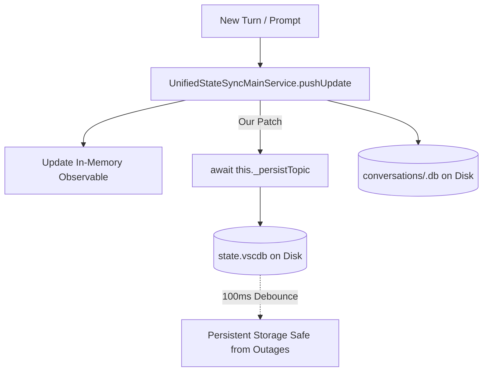

# Antigravity IDE Conversation Persistence & Auto-Recovery 🚀

[](#cross-platform-support)
[](#quick-install)
[](LICENSE)

A lightweight, zero-dependency utility that **permanently prevents conversation history loss** in [Google Antigravity IDE](https://antigravity.google) and restores missing or orphaned conversations after power outages, hard crashes, or unexpected reboots.

---

## ⚡ Quick Install (1-Line Command)

Run the single command below for your operating system:

### 🐧 Linux & 🍎 macOS (Terminal)
```bash
curl -fsSL https://raw.githubusercontent.com/sevencommonfactor/antigravity-conversation-recovery/main/install.sh | bash
```

### 🪟 Windows (PowerShell)
```powershell
irm https://raw.githubusercontent.com/sevencommonfactor/antigravity-conversation-recovery/main/install.ps1 | iex
```

> **What the installer does automatically:**
> 1. ✅ **Patches the Core Engine (`main.js`):** Forces immediate SQLite disk writes whenever a conversation is created or updated.
> 2. ✅ **Enables Dynamic Window Reload:** Ensures refreshing or reopening windows reads the latest disk state.
> 3. ✅ **Recovers Orphaned Conversations:** Scans your conversation databases and indexes missing sessions.
> 4. ✅ **Enforces Strict Workspace Isolation:** Ensures conversations appear **only** in the project folder where they were created.
> 5. ✅ **Sets Up a Background Sentinel:** Automatically runs every 15 minutes (`systemd` on Linux, `launchd` on macOS, `Task Scheduler` on Windows) as a permanent safety net.
> 6. ✅ **Installs CLI Tool:** Puts `antigravity-recover` in your `$PATH`.

---

## 🔍 Why Does Antigravity IDE Lose Conversations?

### The Root Cause
Antigravity IDE separates conversation execution from UI indexing:
1. **Execution Storage:** The Language Server writes complete conversation turns to SQLite databases under `~/.gemini/antigravity-ide/conversations/<uuid>.db`.
2. **UI Sidebar Index:** The sidebar history UI reads **exclusively** from an internal index table in `state.vscdb` (`antigravityUnifiedStateSync.trajectorySummaries`).

### The Flaw in `main.js` (`UnifiedStateSyncMainService`)
In the default IDE build:
- Whenever a conversation is created or updated, `pushUpdate()` updates in-memory state in RAM.
- **`_persistTopic()` is never called during active sessions.**
- Persistence to `state.vscdb` is only triggered when the IDE shuts down cleanly via `saveAllTopics()`.
- **The Result:** If your computer loses power, crashes, or is force-killed, `saveAllTopics()` is bypassed. When you reopen the IDE, the conversation files exist on disk, but the sidebar index was never flushed. To the user, the conversation appears completely gone.

### How This Fix Solves It


1. **Immediate Persistence Patch:** Patches `pushUpdate()` in `main.js` to invoke `await this._persistTopic(n);` immediately on every update. SQLite debounces and writes to disk within 100ms.
2. **Dynamic Window Reload Patch:** Clears stale memory caches on `initIPCSubscription` so reloading a window (`Ctrl+R`) instantly reflects disk updates.
3. **Workspace Isolation Engine:** Reconstructs the exact Protobuf schema (`Field 9: CortexWorkspaceMetadata`) so conversations are strictly bound to their respective projects.

---

## 💻 CLI Commands

Once installed, you can use the `antigravity-recover` command anywhere:

### 1. Check System Health & Status
```bash
antigravity-recover --status
```
*Example Output:*
```text
=== Antigravity IDE Persistence Status ===
Detected OS: Linux
User Home: /home/user
State Database: Found
Engine Core (/opt/antigravity-ide/resources/app/out/main.js):
  - Immediate disk persistence patch: ACTIVE [OK]
  - Dynamic window reload patch:     ACTIVE [OK]
Conversation Databases on disk: 94
Indexed in state.vscdb:         94
Background Recovery Timer:       ACTIVE [OK]
```

### 2. Search & Filter Conversations
Filter by repository name, workspace, or title keyword:
```bash
antigravity-recover --list --filter kora
antigravity-recover --list --filter payment
antigravity-recover --list --filter urbany
```

### 3. List All Indexed Conversations
```bash
antigravity-recover --list
```

### 4. Manual Recovery / Re-index Scan
```bash
antigravity-recover
```

### 5. Safe Preview (Dry Run)
```bash
antigravity-recover --dry-run
```

---

## 🌐 Cross-Platform Support

| Feature | Linux 🐧 | macOS 🍎 | Windows 🪟 |
| :--- | :---: | :---: | :---: |
| **Engine Persistence Patch** | `/opt/antigravity-ide` | `/Applications/Antigravity IDE.app` | `%LOCALAPPDATA%\Programs` |
| **Storage Location** | `~/.config/Antigravity IDE` | `~/Library/Application Support` | `%APPDATA%\Antigravity IDE` |
| **Background Daemon** | `systemd --user` timer | `launchd` LaunchAgent | Windows Task Scheduler |
| **Strict Workspace Filter** | ✅ Supported | ✅ Supported | ✅ Supported |
| **1-Click One-Line Install** | ✅ Supported | ✅ Supported | ✅ Supported |

---

## 🛠️ Upgrades & Package Updates (`apt upgrade`)

If an operating system upgrade (such as `apt upgrade antigravity` or re-installing the application bundle) replaces `main.js` with a fresh upstream binary:
- Your background timer and recovery tool remain active.
- To re-apply the core engine persistence patch to the new binary, simply run:
  ```bash
  ~/setup-antigravity-fix.sh
  # or
  antigravity-recover
  ```

---

## 🔄 Uninstallation & Rollback

If you ever want to revert all changes:

### Linux / macOS:
```bash
# 1. Restore original unpatched main.js
cp /opt/antigravity-ide/resources/app/out/main.js.bak /opt/antigravity-ide/resources/app/out/main.js

# 2. Disable background service
systemctl --user disable --now antigravity-recover.timer 2>/dev/null || true
rm -f ~/Library/LaunchAgents/com.antigravity.recover.plist 2>/dev/null || true

# 3. Remove wrapper and tools
rm -f ~/.local/bin/antigravity-recover
```

---

## 📄 License
MIT License. Free for all developers using Google Antigravity IDE.
